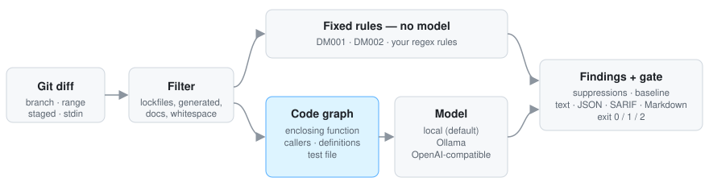

# Diffmind: local-first AI code review for git diffs

[](https://github.com/thinkgrid-labs/diffmind/actions/workflows/ci.yml)
[](https://github.com/thinkgrid-labs/diffmind/releases/latest)
[](LICENSE)
[](#install)

**Review the change. See what it touches.**

Diffmind reviews a `git diff` for security issues, bugs and quality problems.
It reads each change together with the function around it, the code that calls
it and the definitions it uses, taken from a code graph it builds of your
repository. A local model is the default, so there is no API key and the code
stays on your machine. The same engine runs in your terminal, in git hooks and
as a CI gate in GitHub Actions or any other CI.

## Why Diffmind

- **Repository-aware.** A tree-sitter code graph (13 languages, stored as a
  local SQLite file) adds callers, definitions and tests to each hunk, so a
  changed signature is judged against the code that uses it.
- **Local by default.** The built-in Qwen2.5-Coder model runs inside the
  binary after a one-time download. You can point Diffmind at your own Ollama
  or OpenAI-compatible server instead.
- **A gate you can keep.** Stable rule IDs, inline suppressions, a baseline for
  existing code, and exit codes that tell "findings" (1) apart from "failed or
  incomplete review" (2).
- **Two kinds of findings, clearly labelled.** Deterministic checks (commented-out
  code, a removed declaration still referenced in the same hunk, your regex
  rules) never vary. Model findings are labelled as such and depend on the
  model you choose.
- **One Rust binary.** macOS, Linux and Windows, installed with a shell
  script, npm or Cargo.

## Install

```bash
# macOS and Linux (x86_64, arm64): checks the release SHA-256 when it can
curl -fsSL https://github.com/thinkgrid-labs/diffmind/releases/latest/download/install.sh | bash

# npm: the binary ships in a per-platform optional dependency
npm install -g @diffmind/cli

# from a clone of this repository
cargo install --path apps/tui-cli
```

Pin a version with `curl -fsSL … | VERSION=v0.9.3 bash`. On Windows, download
`diffmind-x86_64-pc-windows-msvc.zip` from
[Releases](https://github.com/thinkgrid-labs/diffmind/releases) and put
`diffmind.exe` on your `PATH`. Linux binaries are glibc-linked; on Alpine, use
a glibc base image or build from source.

## Quickstart

```bash
diffmind download     # one-time: the default 1.5B model, 1.1 GB
cd your-repo
diffmind              # review this branch against the default branch
diffmind --tui        # the same review, step by step in the terminal
```

Nothing else needs configuring. The first review also builds the code graph.
Other targets: `--last` (last commit), `--staged`, a range such as
`v1.2.0..HEAD`, paths such as `src/api/`, or `--stdin`.

## Example

A commit that hardcodes a password and weakens a token check, plus one regex
rule in `.diffmind/rules.toml`:

```diff
+ADMIN_PASSWORD = "hunter2"
+password = "hunter2"
+
 def is_valid_token(token: str) -> bool:
     """Reject empty and obviously malformed session tokens."""
-    if not token:
-        return False
-    return len(token) == 32 and token.isalnum()
+    # if not token:
+    #     return False
+    return len(token) >= 0
```

`diffmind --last` with v0.9.3 and the default 1.5B model, on CPU. This is real
output with colours removed and lightly trimmed:

```text
 HIGH  security  app/auth.py:1 [#1] (DM001)
 Issue  Security-sensitive logic has been entirely commented out (3 lines).
        The block is now dead code and will not execute — this may silently
        break authentication or validation.
 Fix    Restore the logic if it should be active, or remove the commented
        block entirely.

 HIGH  security  app/auth.py:2 [#2] (no-hardcoded-password)
 Issue  Hardcoded password — load it from the environment or a secrets manager

 HIGH  security  app/auth.py:1 [#3] (DM900.security)
 Issue  The `ADMIN_PASSWORD` is hard-coded in the code, which makes it
        vulnerable to attackers who can easily access the source code.
 Fix    Replace the `ADMIN_PASSWORD` with a secure environment variable or a
        configuration file.

 ✓ What looks good
   · The function `is_valid_token` checks if the token is not empty and has a
     length of at least 0, which is a good practice.

 ⚠  3 findings · 3 at or above the fail threshold  (exit 1)
```

The two deterministic findings (`DM001` and the regex rule) will appear the
same way on every run. The model finding (`DM900.security`) repeats the
password issue, but the 1.5B model **missed the real bug**: `len(token) >= 0`
is always true, so every token now passes. That is typical of a small model,
and it is why model findings are labelled separately. For changes that matter,
use a larger model ([Models and providers](docs/providers.md)).

## How it works



1. **Filter** out lockfiles, generated files, docs, editor and agent config,
   and whitespace-only hunks. The counts are printed.
2. **Run fixed rules** with no model: `DM001`, `DM002` and your `rules.toml`
   regex rules.
3. **Add context** from the code graph: the enclosing function, callers of
   changed symbols, definitions used and the matching test file.
4. **Review with the model**, unit by unit, with your written rule sets. The
   built-in backend uses JSON-constrained decoding.
5. **Report and gate**: apply suppressions and the baseline, write text, JSON,
   SARIF or Markdown, and exit 0, 1 or 2.

The graph matches symbols by name, not by full type resolution, and labels
ambiguous matches as "possible". Languages without a parser are still
reviewed, just without callers. Details: [How Diffmind works](docs/how-it-works.md).

## Models and providers

| Provider | Status | Code leaves your machine? |
| --- | --- | --- |
| Built-in local model (Qwen2.5-Coder, 0.5B–32B) | **Default** | No (one-time model download from Hugging Face) |
| Ollama | Supported | Only if the server is remote |
| OpenAI-compatible server (vLLM, LM Studio, llama.cpp, LiteLLM, …) | Supported protocol; specific servers not tested by the project | Only if the server is remote |
| Hosted APIs (Anthropic, OpenAI, …) | No built-in backend yet ([roadmap](ROADMAP.md)) | |

```bash
diffmind --backend ollama --backend-model qwen2.5-coder:14b
```

Remote backends receive the diff and its context, and a committed
`config.toml` can select one, so check it in repositories you do not trust.
API keys come only from an environment variable (`DIFFMIND_API_KEY` by
default), and are refused over plain `http://` to a non-local host. There is no OAuth. Bigger models give better
findings and run slower. Only the built-in backend uses constrained decoding,
and its output is repeatable on the same machine. Setup, credentials and
trade-offs: [Models and providers](docs/providers.md).

## GitHub Actions and CI

```yaml
permissions:
  contents: read
  security-events: write          # for SARIF upload

steps:
  - uses: actions/checkout@v4
  - uses: thinkgrid-labs/diffmind@v0.9.3
    with:
      version: v0.9.3             # pin the binary too; the default is "latest"
      fail-on: high
```

The action caches the model, reviews the pull request under the base branch's
`.diffmind/` configuration, and uploads SARIF so findings appear inline on the
diff. It needs no secret beyond the workflow's built-in token. Set
`format: markdown` and `comment: true` for a PR comment instead.

Anywhere else:

```bash
git diff origin/main...HEAD | diffmind --stdin --format sarif --output diffmind.sarif --fail-on high
```

| Exit | Meaning |
| --- | --- |
| `0` | Review complete; nothing at or above `--fail-on` |
| `1` | Review complete; findings at or above `--fail-on` |
| `2` | Diffmind failed, or part of the diff was not reviewed (fails by default in CI) |

Git hooks: `diffmind install-hooks --hook pre-push`, or the
[pre-commit](https://pre-commit.com) hook `id: diffmind`. Inputs, permissions,
fork behaviour and the limits of the config protection:
[CI, GitHub Actions and git hooks](docs/ci.md).

## Documentation

- [Using Diffmind](docs/usage.md): review targets, the TUI, suppressions,
  baselines, `stats`, team rules, configuration and every flag
- [How Diffmind works](docs/how-it-works.md): the pipeline, the code graph,
  supported languages, reproducibility, prompt injection
- [Models and providers](docs/providers.md): local models, Ollama,
  OpenAI-compatible servers, credentials, privacy
- [CI, GitHub Actions and git hooks](docs/ci.md)
- [Example rule set for Next.js](examples/nextjs-app-router/)
- [Changelog](CHANGELOG.md) · [Roadmap](ROADMAP.md)

## Capabilities and limitations

**What it does today:** review any text diff; add code-graph context for 13
languages; run deterministic checks and your regex rules; apply team rule sets
written in Markdown; report as text, JSON, SARIF 2.1.0 or Markdown; gate CI
with exit codes and a completeness check; keep findings quiet with suppressions
and a baseline; record verdicts and measure accept/wrong rates; run locally,
through Ollama or through an OpenAI-compatible server.

**What to keep in mind:**

- **It is a review assistant, not a guarantee.** Model findings can be wrong,
  and the default 1.5B model produces false positives, including high-severity
  ones. It is not formal static analysis, and a clean review does not mean the
  code is correct.
- **`--fail-on` is a severity threshold for all findings.** It cannot yet be
  limited to deterministic findings. If model false positives block your
  builds, use a higher threshold or a larger model, or in the GitHub Action
  set `fail-on: none` and treat the review as advisory.
- **Triage can skip files.** When six or more files change, a first pass may
  skip files it judges low-risk. They are counted in the report, but the
  review still counts as complete. Use `--triage off` to review every file.
- **Check the config of repositories you do not trust.** A committed
  `.diffmind/config.toml` can select a remote backend and the environment
  variable used as its API key. Read it before running Diffmind, or its git
  hooks, in an untrusted clone. (The GitHub Action pins the local backend.)
- **CPU inference takes minutes in CI.** With the 1.5B model, a two-unit
  review took roughly 45 seconds on a GitHub-hosted Linux ARM64 runner and two
  to six minutes on Linux x86_64 and Windows runners. Metal is used on macOS
  when available; there is no CUDA support.
- **Repeatable per machine, not across machines.** Output can differ in
  wording or by a line between different hardware. Remote backends make no
  repeatability promise.
- **Prompt injection is reduced, not prevented.** The code under review can try
  to instruct the model.
- **The action's config protection has gaps.** It needs a base branch, so it
  does not cover `merge_group` or `push` events unless you set `base`, and it
  does not cover generated-file markers. See [CI](docs/ci.md#what-a-pull-request-can-change).
- **Size limit.** A diff larger than 1.5 MB after filtering is refused; review
  paths separately.
- **Platforms.** Prebuilt binaries for macOS (arm64, x86_64), Linux glibc
  (x86_64, arm64) and Windows x86_64. No musl build.

## Roadmap

- **v0.9.4:** close the known CI-gate gaps (merge queues, generated-file
  markers) and improve the first-run experience
- **v0.10.0:** gate on deterministic findings only, a public review-quality
  benchmark, faster CPU reviews
- **v0.11.0:** opt-in hosted models, with the local model triaging what the
  hosted one reads
- The built-in local model stays the default

Full plan, with what is already shipped: [ROADMAP.md](ROADMAP.md).

## Contributing

Issues and pull requests are welcome. Before opening a pull request:

```bash
cargo test --workspace --all-targets
cargo clippy --workspace --all-targets -- -D warnings
cargo fmt --all
```

Adding a code-graph language is a good first contribution: a tree-sitter
grammar crate plus one entry in the `LANGUAGES` table in
[`graph/extract.rs`](apps/tui-cli/src/graph/extract.rs).

## License

MIT. See [LICENSE](LICENSE).
