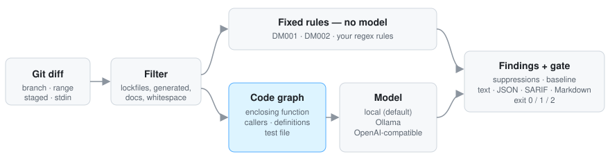

# How Diffmind works

## The review pipeline

1. **Parse.** The diff becomes per-file hunks with correct old and new line
   numbers. Paths are read with `core.quotepath=false`, so non-ASCII file names
   work.
2. **Filter.** Lockfiles, `linguist-generated` paths, `@generated` banners,
   minified bundles, assets, snapshots, documentation, coding-agent and editor
   config (`.claude/`, `.cursor/`, `.vscode/`, …), ignore files, formatter
   settings, your `ignore` globs and whitespace-only hunks are dropped, and the
   counts are printed. `node_modules`, `vendor`, `target`, `dist`, `build`,
   `.next` and `.cache` are excluded before that, when the diff is taken. Whitespace inside a string still counts as a change, and
   indentation is never dropped in Python or YAML. Tests are kept.
3. **Fixed rules.** `DM001` (commented-out code), `DM002` (a declaration removed
   while something still uses it) and your `rules.toml` regex rules. No model
   is involved.
4. **Context.** For each review unit, Diffmind reads from the code graph the
   function the hunk is in, the callers of each changed symbol, the definitions
   it refers to and the matching test file. Context has a size budget, so it
   does not grow with the repository. Code is read from your working tree at
   review time. If the working tree is not the diff's post-image (for example
   `--range a..b` with another commit checked out), context is withheld and the
   run says so.
5. **Triage.** When six or more files change (`--triage auto`), a quick first
   pass may skip files it judges low-risk. Skipped files are counted in the
   report (`files_skipped_by_triage` in JSON) but do not make the review
   incomplete. `--triage off` reviews every file.
6. **Group.** Hunks are grouped by enclosing function or area rather than cut at
   a fixed line count. A changed symbol and its changed callers are reviewed
   together. Unit size follows the model's real context window.
7. **Model.** Each unit is sent to the selected model with your matching rule
   sets. The built-in backend uses a JSON-constrained sampler, so the model
   cannot write prose around its answer, and output cut off at the token limit
   is repaired where possible. A unit whose answer still cannot be parsed is
   reported as unreviewed.
8. **Anchor.** Findings about files outside the unit are dropped. Line numbers
   that are slightly off snap to the nearest changed line.
9. **Silence and gate.** Inline suppressions, the baseline and
   `--min-confidence` are applied, duplicates removed and results sorted. The
   report is written and the exit code set (0 clean, 1 findings at or above
   `--fail-on`, 2 failed or incomplete).

Results are cached per unit, keyed on the exact prompt, sampling options and
backend identity, under an HMAC with a per-user secret, so editing one function
re-reviews only that function and a branch cannot plant cached results.

## The code graph

Most diff reviewers see a hunk and a filename. Diffmind indexes the repository
with [tree-sitter](https://tree-sitter.github.io/) and stores definitions and
references in `.diffmind/graph.db`, a local SQLite file. Each review asks it
four questions:

| Question | What the model gets |
| --- | --- |
| Which function contains this line? | The whole function, so a hunk is not read alone |
| What does this hunk define? | The symbols that changed |
| What calls this symbol? | The call sites that may break |
| Where is this name defined? | The helpers and types the hunk uses |

- **Built automatically.** A review builds the graph on first run and refreshes
  it before each later run (`--no-index` or `auto_index = false` to skip).
  `diffmind index` does the same on demand; `--rebuild` starts over.
- **Stores locations, not code.** Definitions are stored as line ranges and the
  source is read from your files when needed, so a snippet cannot disagree with
  the file under review.
- **Fresh by content.** A file is re-parsed when its modification time, change
  time or size differ, and "racily clean" files are re-hashed. A file that stops
  parsing drops its old symbols. A corrupt database is rebuilt.
- **Local.** No server, no hosted index, no account. It is gitignored by
  default and safe to delete.

### What the graph does not do

The graph matches references **by name**. It does not resolve types, imports
or overloads the way a compiler does. When several definitions share a name, a
match is labelled "Possible caller" or "Possible definition" rather than
presented as certain. References are deliberately narrow (function calls,
constructors, type names); recording every identifier would make "what calls
this" return half the repository. So the graph gives the model useful nearby
code. It is not whole-program analysis.

### Languages

The review works on **any text diff**: every language, plus config files, SQL
and shell scripts. The fixed rules and your regex rules run on every added
line that survives filtering.

Only the code graph needs a parser. Diffmind ships 13:

| Language | Extensions |
| --- | --- |
| Rust | `.rs` |
| TypeScript | `.ts` `.mts` `.cts` |
| TSX | `.tsx` |
| JavaScript | `.js` `.jsx` `.mjs` `.cjs` |
| Python | `.py` `.pyi` |
| Go | `.go` |
| Java | `.java` |
| C# | `.cs` |
| Ruby | `.rb` `.rake` |
| PHP | `.php` |
| C | `.c` `.h` |
| C++ | `.cpp` `.cc` `.cxx` `.hpp` `.hh` |
| Scala | `.scala` `.sc` |

Files in other languages are still reviewed, with the hunk, a test file found
by naming convention, and your rule sets, but without callers or definitions.

Adding a language takes its tree-sitter grammar crate and one entry in the
`LANGUAGES` table in
[`apps/tui-cli/src/graph/extract.rs`](../apps/tui-cli/src/graph/extract.rs).

## Two kinds of findings

**Deterministic findings** (`DM001`, `DM002`, `custom.*`) match a pattern or do
not. They are pattern checks, not dataflow analysis: `DM002`, for example, only
sees a removed declaration that is still referenced within the same hunk. They cost nothing and do not vary between runs.

**Model findings** (`DM900.*`, `rulebook.*`) are the model's judgement on a
unit, given its context. Their quality depends on the model: the default 1.5B
catches obvious mistakes and also produces false positives, and larger models
do better. Use the TUI's accept/wrong verdicts and `diffmind stats` to see how
often they are right on your code.

## Reproducibility

With the built-in backend and default settings (temperature 0, fixed seed,
JSON-constrained greedy decoding, SHA-256-pinned weights), the same diff gave
byte-identical findings on repeat runs on the same machine during v0.9.3
release validation. Across different hardware, the set of findings matched but
wording and occasionally a line number differed. Remote backends make no such
promise.

## Prompt injection

The code under review is input to the model, and a comment in a diff can try
to instruct it. Diffmind fences repository text with markers the content cannot
forge, breaks up chat-template control tokens, tells the model that fenced text
is data, ignores model findings about files outside the unit, and escapes model
output before it reaches a terminal, Markdown report or PR comment. This
reduces the risk. It does not remove it, which is one reason to prefer blocking
on findings you can verify.
